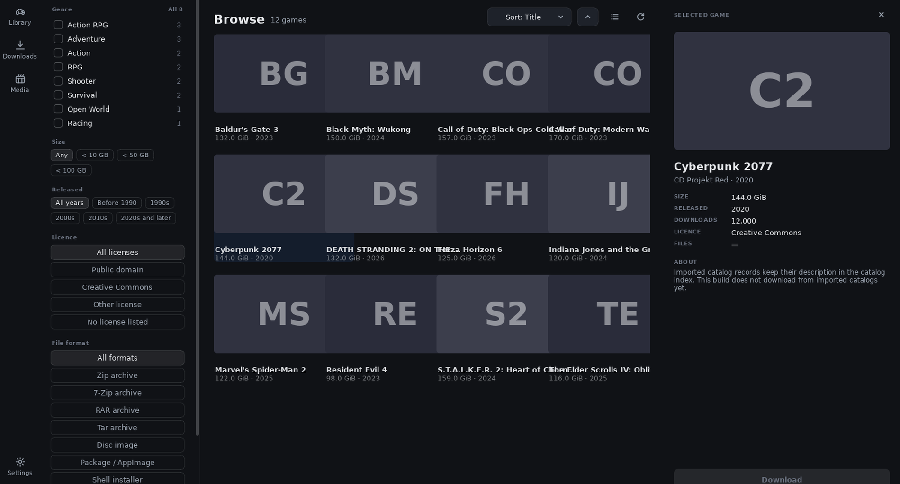
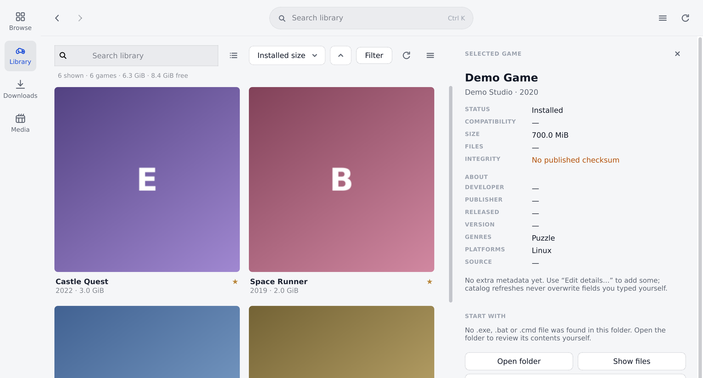
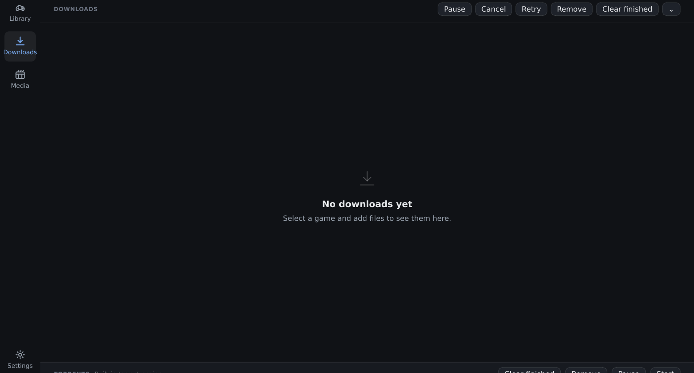

<h1 align="center">Lumora</h1>

<p align="center">
  <strong>A desktop game library and media player — browse, download, organise and play Internet Archive games, then discover and watch Movies&nbsp;&amp;&nbsp;TV in the same app.</strong><br>
  One shared Python core, two native frontends: GTK&nbsp;3 on Linux, Qt&nbsp;6 on Windows.
</p>

<p align="center">
  <a href="https://github.com/kant-sompong/Lumora/releases/latest"></a>
  <a href="https://github.com/kant-sompong/Lumora/actions/workflows/release.yml"></a>
  
  <a href="#license"></a>
</p>



<p align="center"><sub>Browse the collection, filter it, and download in one click — the same window on Linux and Windows.</sub></p>

| Library | Downloads | Movies &amp; TV |
| :---: | :---: | :---: |
|  |  |  |

## Features

- **Browse and filter** — the whole archive.org collection with search, genre/size/year/licence/format filters, lazy artwork, a cover grid or compact list, and a details panel with the file list
- **Downloads that finish** — a queue that survives restarts, segmented transfers with resume, disk-space preflight, atomic renames and bounded retries; magnets through the built-in BitTorrent engine or `aria2c`
- **A library you own** — folder scan into `library.json`, favourites, metadata with provenance, checksum verification, duplicate finder, export/import
- **Reviewed launch** — you pick the executable, the path must stay inside your download folder, and elevated launches are refused
- **Movies &amp; TV** — TMDB metadata, anime discovery via MyAnimeList/AniList and ani.pm, episode selection, provider selection and in-app playback for supported providers
- **Discovery and home screens** — recommendations, random discovery, hidden gems, recently viewed history, custom shelves and a release calendar
- **Personal library tools** — collections, tags, duplicate detection, bulk edits, metadata editing, statistics, activity history and profile separation
- **A configurable interface** — command palette, keyboard shortcuts, compact mode, accent colours, artwork backgrounds and adjustable home layouts
- **Website catalogues** — import Kryoto, RAWG, archive.org or any JSON/HTML catalogue page into the same library

## Install

### Windows

Download **`Lumora-Setup-x64.exe`** (per-user installer, no administrator prompt) or the portable **`Lumora-Windows-x64.zip`** from the [latest release](https://github.com/kant-sompong/Lumora/releases/latest). Nothing else to install — the build is self-contained and bundles Qt WebEngine for playback.

The executable is unsigned, so SmartScreen may warn: choose **More info → Run anyway**. Some antivirus heuristics also flag PyInstaller binaries; that is a known false positive.

### Linux

```sh
git clone https://github.com/kant-sompong/Lumora.git
cd Lumora
./run.sh              # or: python3 -m lgl
```

Needs Python 3.10+ and GTK 3; WebKit2GTK and the GStreamer plugins are optional and only used for embedded playback.

<details>
<summary><strong>Distribution packages</strong></summary>

| Distribution | Command |
| --- | --- |
| Void Linux | `sudo xbps-install -Su python3 gtk+3 python3-gobject python3-cairo gdk-pixbuf xdg-utils` |
| Debian / Ubuntu | `sudo apt install python3 python3-gi python3-gi-cairo gir1.2-gtk-3.0 xdg-utils` |
| Fedora | `sudo dnf install python3 python3-gobject gtk3 xdg-utils` |
| Arch | `sudo pacman -S python python-gobject gtk3 xdg-utils` |

</details>

## Docs

- [Features](docs/FEATURES.md) — everything the app does, section by section
- [Screenshots](docs/SCREENSHOTS.md) — every screen, including Settings, the Windows build and the Kryoto catalogue
- [Reference](docs/REFERENCE.md) — requirements, API keys, streaming providers, keyboard shortcuts, where data is stored, troubleshooting
- [Developing](docs/DEVELOPING.md) — architecture, building from source, CI, tests
- [Roadmap](docs/ROADMAP.md) — known gaps
- [What’s next](docs/TODO.md) and [completed work](docs/DONE.md) — current project hand-over and verification notes

## License

MIT. Third-party components: aria2 (GPLv2, only when bundled as `aria2c.exe`), PyInstaller bootloader (GPLv2 with a runtime exception), Qt 6 / PySide6 (LGPLv3), and Chromium via Qt WebEngine (BSD-style licences).

<p align="center"><sub>Built with Python, GTK and Qt — for people who still own their files.</sub></p>
