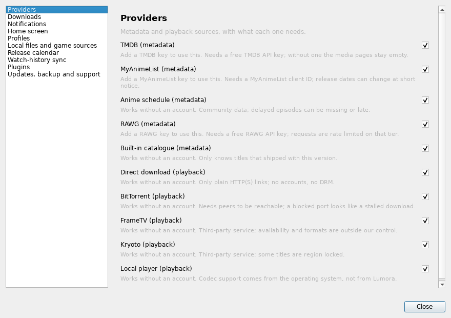

# UI parity

Both editions are expected to answer the same questions in the same places. This
page records where each capability lives, so a change on one platform has an
obvious counterpart to update.

## Shared entry points

| Capability | Linux | Windows |
| --- | --- | --- |
| Global search | header search pill (`Ctrl+F`) | header search field (`Ctrl+F`) |
| Downloads | downloads pane | downloads view |
| Settings | app menu → Settings… | app menu → Settings… |
| Tools (this release) | app menu → Tools… | app menu → Tools… |
| Updates | Tools → Updates, backup and support | same section |
| Backup and support report | Tools → Updates, backup and support | same section |
| Providers | Tools → Providers, and Settings → Providers | same |
| Collections | library sidebar | library pane |
| Continue watching | Movies & TV home shelf | same |

## The Tools window

Both frontends render the same ten sections from `lgl/tool_panels.py`:
Providers, Downloads, Notifications, Home screen, Profiles, Local files and game
sources, Release calendar, Watch-history sync, Plugins, and Updates/backup/support.

Because the rows come from one model, a label or behaviour change lands on both
platforms at once; only the widget mapping differs.

## States

Every new screen states its condition rather than showing a blank area:

- **Empty** — "No plugins installed", "No media folders", "Nothing scheduled".
- **Unavailable** — a provider says what is missing ("Add a TMDB key to use this").
- **Error** — every failure path produces a sentence, never a stack trace or a
  silent no-op.

## Known gaps

- The Windows desktop-notification backend is not implemented; the toggle exists
  and is honest about doing nothing.
- GTK and Qt draw their own cards, so spacing and typography are visually close
  but not pixel-identical. Navigation, wording and behaviour are aligned.
